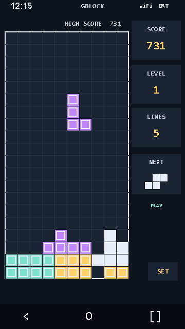

# GBLOCK

A gesture-controlled falling-block puzzle game for Android. Stack pieces, clear lines, and beat your high score with simple touch controls and a retro look.

**[Download GBLOCK on itch.io](https://terrapunks.itch.io/gblocks)**

## Install

Requires **Android 7.0 or newer**.

1. Visit the [GBLOCK itch.io page](https://terrapunks.itch.io/gblocks) on your Android device and download the APK.
2. Open the downloaded file. If Android asks, allow installation from the browser or file manager you used.
3. Install GBLOCK and open it from your app drawer.

Playable builds are distributed through itch.io. This repository contains the source code and build instructions.

## How to play

Fill horizontal rows to clear them and earn points. Keep the stack from reaching the top as the game speeds up.

| Gesture on the playfield | Action |
| --- | --- |
| Tap | Rotate the piece clockwise |
| Drag left or right | Move the piece sideways |
| Drag down | Lower the piece faster |
| Flick down with a long, fast motion | Drop the piece instantly |
| Tap with two fingers | Pause or resume |

Use the on-screen resume button to continue a paused game. Opening settings or leaving the app pauses play; returning to the game lets you resume when you are ready.

## Features

- Gesture controls that keep the playfield clear of buttons.
- Colorful GBLOCK and monochrome Handheld skins.
- Adjustable gesture sensitivity.
- Score, high score, level, cleared-line count, and next-piece preview.
- Sound effects, music controls, and adjustable volume.
- Saved game recovery that restores play in a paused state.

## Preview

Default skin layout preview:



## Build from source

Built with Kotlin and Jetpack Compose, with a separate Kotlin game core.

Open the project in Android Studio with **JDK 21** and **Android SDK 37** installed. Let Gradle sync, then run the app on an Android device or emulator.

To run tests and build a debug APK on Windows:

```powershell
.\gradlew.bat test assembleDebug --no-daemon
```

On macOS or Linux:

```sh
sh gradlew test assembleDebug --no-daemon
```

The built APK is written to `app/build/outputs/apk/debug/app-debug.apk`.

## Feedback

Found a bug or have an idea? [Open an issue](https://github.com/tofonion/gblock/issues) with a description and, for bugs, your device model, Android version, and steps to reproduce it.
